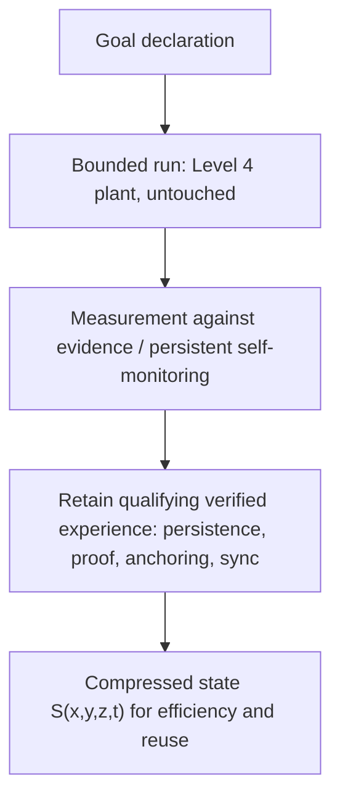

# Aethel Node

Aethel Node turns a declared goal into a bounded run, measures the result against evidence, and keeps only the experience that qualifies for reuse.

The claim is narrow: a verified, reusable workflow can reduce repeated work and next-action error. Retention, savings, and willingness to pay still have to be shown with external users and measured outcomes. “Conscious” is a product metaphor for persistent state, feedback, and continuity across runs, not a claim about machine consciousness.

Live: https://shiyan-dap.vercel.app  
Repo: https://github.com/ecmccready/shiyan-dap

Scope: diagnostics and the related pipelines (Level 4 plant, safety, MCP, micro-ledger, proof-to-pilot). Nothing here is a clinical product, and the system handles no PHI.

## My stack: Aethel Node / Shiyan DAP — scope, propriety, and 4D-SCP

This is my stack: Aethel Node, in this repository also called Shiyan DAP. Aethel Node turns a declared goal into a bounded run, measures the result against evidence, and keeps only the experience that qualifies for reuse. The loop is Connect → Execute → Prove → Learn.

### Scope and boundaries

The work is limited to diagnostics and related pipelines: the Level 4 plant, safety, MCP, the micro-ledger, and the proof-to-pilot journey. Nothing here is a clinical product, and the system handles no PHI. Demonstration, test, and benchmark data is synthetic or fixture data and is labelled as such.

Boundaries I keep:

- **Level 4 plant.** It is the authoritative execution and verification path. Other subsystems, including the commercial surfaces and the 4D-SCP proofs, do not modify it.
- **Tenant boundary.** Production writes, proofs, and anchors are scoped per tenant.
- **Commercial surfaces.** Workbench, customer proof export, and related pages are inspect-only or human-in-the-loop. They do not replace the closed loop or the plant.

### Propriety

This repository currently declares no open-source license: there is no `LICENSE` file, and `package.json` is marked private with no `license` field. The source is published here for inspection. That publication is not a grant of rights to use, copy, modify, or distribute the work beyond the terms of the host. I reserve rights in the Aethel Node stack, including the 4D state compression engine, the 4D-SCP (Four-Dimensional State Compression Processor) model and proofs, and the deterministic proof and anchoring layers, until a license is stated.

### Note: Early sole-founder and proprietary intent

I stated sole-founder and proprietary intent for this stack publicly from its early days:

- 2026-11-08: “I am the founder who implemented a stack to be run by Agents-Unicorn trajectory.” ([post](https://x.com/ecmccready/status/2119414352646463494))
- 2026-11-09: “Maximize probability, learning velocity, and evidence generation as the Sole Founder of a Unicorn running an autonomous company.” ([post](https://x.com/ecmccready/status/2119921969353347499))
- 2026-11-12: “Building, optimizing for differentiation, defensibility and proprietary” ([post](https://x.com/ecmccready/status/2120696926475874520))
- 2026-11-14: “this stack has be the messenger boy, monopoly of proprietary.” ([post](https://x.com/ecmccready/status/2121441168940823024))

### End-to-end with 4D-SCP

Aethel Node and 4D-SCP are one intended pipeline, from a declared goal to a compact, reusable state:



Today that relationship is only partly in production, and I am precise about the split:

- The **4D state compression engine** (M1–M5) is live in production for `prod-a`: lossless and windowed summaries, append-only segments, customer proof export, chain-head anchoring, and scheduled state-chain sync. It serves the Learn end of Connect → Execute → Prove → Learn. Design: `docs/design/4d-state-compression.md`.
- **4D-SCP** (v0.1 through v0.1.18, and v0.1.20) is the Four-Dimensional State Compression Processor for the representation S(x,y,z,t). It is a software model with integer golden vectors plus RTL simulation and synthesis proofs, all on labelled synthetic and fixture data. The code lives in `src/scp/` and `hw/scp4d/`, is imported by no route and no Level 4 module, and is not wired into production. Cycle counts are measured in simulation. Energy and area figures are model or synthesis estimates, not measured silicon. Architecture and honest claims: `docs/design/4d-scp-architecture.md`. Check inventory: under Status below, and `scripts/check-scp-all.ts`.

The value of the build is the verified software model, the bit-exact proofs, and the isolated stack, not any single hardware timing result.

## Status

Phase 1 is complete. Phase 2 (MCP + boundary) is current. Phase 3 asset map and audit summary are live. Work is focused on the proof-to-pilot journey on the existing engine. No new architectural phases are planned.

- **4D-SCP v0.1.20 (live proof path, unwired):** five-seed E1–E5 on the existing subsystem. Measured verdicts in `fixtures/scp/v0120-proof-report.json`: H1 PASS, H2 PASS, H3 PASS (low median ratio 2.042077644429328 and medium 1.8332024775364215, 5/5 seeds), H4 MIXED (stream bytes win, state bytes lose), H5 PASS (flips at high). K1 `hw/scp4d/rtl/scp4d_ede.v` is bit-exact in Icarus in temporal-only mode and with the relations mode bit; the full-scan baseline is `scp4d_fsd.v`. Place-and-route waits on the v0.1.19 harness. Power needs a real board (Lattice ECP5 Versa or equivalent). Reproduce: `scripts/check-scp-v0120.ts`, `scripts/check-scp-v0120-rtl.ts`. Spec §27.
- Level 4 plant, durable experience store, replay verification, and the Workbench MCP contract are live and are not modified by the commercial surfaces.
- Phase 3 surfaces (asset map, audit summary) are read-only and off-chain.
- Eight original test events remain in the ledger. Only the project owner can purge them.
- **Production status (2026-11-16):**
  - Neon storage and anchors projects are live in Production.
  - Tenant auth (`AETHEL_TENANT_KEYS`) is configured and verified on Production.
  - 4D state compression is live for `prod-a`: chain persisted and anchored, and the customer proof export shows `state_compression` present and anchored.
  - The GitHub Actions `state-chain-sync` workflow is live. Manual dry-run and write-mode runs both PASS, and the schedule (every 6 hours at :17 UTC hours 0/6/12/18) writes automatically.
  - Level 4 plant is untouched.
- Production security close-out (2026-11-14) is complete: anchor and GitHub credentials rotated, unused env vars removed, schema guard green, acceptance passing with independent anchors.
- 4D state compression engine:
  - **Built and tested:** M1 to M5:
    - M1: pure, lossless core.
    - M2: read-only per-tenant reader.
    - M3: 256-run windows with a 24 h cutoff, opt-in bounded-loss and per-segment context.
    - M4: append-only `shiyan.state_segments`, migration 004.
    - M5: customer proof export field, plus anchoring of the chain head in the anchors project, migration `db/migrations/005_shiyan_state_chain_anchors.sql`.
  - **Customer proof export:**
    - With `SHIYAN_STATE_COMPRESSION=1` on the deployment, `GET /api/v1/customer-proof/{id}` gains a read-only `state_compression` field: the tenant's chain head, segment count, sealed-through time and anchor status.
    - Off by default. When off, the response is byte-identical to before.
    - The field is outside `content_sha256` and never fails the export.
  - **Writes:** only through the local CLIs `scripts/persist-tenant-segments.ts` (storage) and `scripts/anchor-state-chain.ts` (anchors). Both need `SHIYAN_STATE_COMPRESSION=1` plus `--write`, refuse rather than overwrite, and print only hashes and counts.
  - **Scheduled sync (live):** `.github/workflows/state-chain-sync.yml` runs every 6 hours (`17 */6 * * *`) and calls `scripts/sync-state-chains.ts` for the tenants in the repository variable `SHIYAN_SYNC_TENANTS`.
    - Repository secrets `SHIYAN_STORAGE_URL` and `SHIYAN_ANCHOR_URL` hold the connection strings. Repository variables: `SHIYAN_SYNC_TENANTS=prod-a,prod-b`, `SHIYAN_SYNC_WRITE=true`.
    - Scheduled runs write because `SHIYAN_SYNC_WRITE` is `true`. Manual runs write only when dispatched with `write=true`.
    - Dry run first, idempotent, fail-closed per tenant; logs show only hashes, counts and pending-window times (`pending_opened_at` / `pending_seals_at`, or `pending_seals_at=none`).
    - GitHub may delay or drop scheduled runs; each run catches up, so this is harmless.
    - **Least-privilege roles (migration 006):** create non-admin Neon roles `shiyan_sync` (storage project) and `shiyan_anchor_sync` (anchors project) in the Console so Neon generates the passwords, then apply `db/migrations/006_shiyan_sync_role.sql` and `db/migrations/006_shiyan_anchor_sync_role.sql` as each project's owner. Confirm with `scripts/verify-sync-roles.ts --storage-file <sync-url> --anchor-file <anchor-sync-url>`, then point the `SHIYAN_STORAGE_URL` and `SHIYAN_ANCHOR_URL` Actions secrets at those role URLs. Apply steps: `docs/design/4d-state-compression.md`.
    - Disable with `gh workflow disable state-chain-sync.yml`, or return to dry runs with `gh variable delete SHIYAN_SYNC_WRITE`.
  - Design and decisions: `docs/design/4d-state-compression.md`.
  - **4D-SCP (v0.1 fixture proof + v0.1.1–v0.1.17, unwired):** architecture at `docs/design/4d-scp-architecture.md` (§7.6–§7.9, §11, §15 honest claims). Isolated stubs and measured packing helpers in `src/scp/` are imported by no route and no Level 4 module. Boundary check: `scripts/check-scp-boundary.ts`. Software proof (fixtures only): `scripts/check-scp-v01.ts`. Defensible size baselines: `scripts/check-scp-v011.ts`. Stress measurement: `scripts/check-scp-v012.ts`. Fair same-eps lossy baselines: `scripts/check-scp-v013.ts`. Software cost / latency / memory: `scripts/check-scp-v014.ts`. Layer 2 analytical hardware cost model (estimates only): `scripts/check-scp-v015.ts`. Divider-free reciprocal quantize variant (test-only; pack.ts unchanged): `scripts/check-scp-v016.ts`. Rounding-exact divider-free reciprocal variant (test-only; pack.ts unchanged): `scripts/check-scp-v017.ts`. Integer-only golden model and golden vectors (test-only; pack.ts unchanged): `scripts/check-scp-v018.ts`. Isolated subsystem `src/scp/subsystem/` (state_encoder … compression_bench) and four-strategy proof bench on fixtures plus a seeded synthetic 4D environment (software simulation; energy figures are estimates): `scripts/check-scp-v019-bench.ts`, report `fixtures/scp/v019-bench-report.json`, spec §16. Integer-only, hash-free scp4d golden model with fixed-point relations/low-rank, event-driven decoder, compute-energy verdict (MIXED; model estimates) and FPGA reference vectors (test-only): `scripts/check-scp-v0110.ts`, report `fixtures/scp/v0110-int-report.json`, vectors `fixtures/scp/golden-vectors-scp4d.json`, spec §17. Synthesizable Verilog decoder for the temporal-only event path in `hw/scp4d/`, bit-exact against the v0.1.10 model in Icarus Verilog, with measured cycle counts and Yosys/nextpnr estimates (energy not measured): `scripts/check-scp-v0111-rtl.ts`, report `fixtures/scp/v0111-rtl-report.json`, vectors `fixtures/scp/golden-vectors-scp4d-temporal.json`, spec §18. Verilog relations decoder for the event-driven path (`hw/scp4d/rtl/scp4d_rdec.v`), bit-exact on 8 relations streams with measured cycles; verdict on relations in hardware (DEPENDS: 1.84× fewer bytes for 1.84× the cycles; worth it only when stream bytes are expensive, labelled estimates): `scripts/check-scp-v0112-rtl.ts`, report `fixtures/scp/v0112-rtl-report.json`, vectors `fixtures/scp/golden-vectors-scp4d-relations.json`, spec §19. Front end reading W = 1, 2 or 4 bytes per cycle for both RTL decoders (`hw/scp4d/rtl/scp4d_fe_w.v`, `scp4d_tdec_w.v`, `scp4d_rdec_w.v`), bit-exact at every W with measured cycles (temporal-only env T64: 2.00× fewer cycles at W = 2, 3.67× at W = 4; relations: 1.16×); W = 2 is the wall-clock sweet spot (synthesis estimates; energy not measured): `scripts/check-scp-v0113-rtl.ts`, report `fixtures/scp/v0113-rtl-report.json`, spec §20. v0.1.14 adds an RTL encoder, `hw/scp4d/rtl/scp4d_tenc_w.v`, for the temporal-only path (2 bytes per cycle out, L = 1–8 integer codes per cycle in, zero / last / linear) and a closed encode → decode loop with `scp4d_tdec_w`. Its output matches the v0.1.10 model byte for byte on 18 jobs × 4 configurations, also under random gaps and backpressure. The loop is bit-exact on all 18 jobs. On env T64 the encoder takes 131,796 / 65,911 / 36,656 / 29,204 cycles at W1L1 / W2L2 / W2L4 / W2L8, and the loop at L = 8 takes 29,986 cycles. The decoder (W = 2) takes 28,444. Synthesis and P&R estimates for W2L8 on ECP5-45F: 12,360 LUT, 4,786 FF, 24 DP16KD, 1 MULT18 at 35.86 MHz, i.e. ~161 M values/s. The encoder keeps up per cycle only at L = 8, and in wall clock it does not (0.85× the decoder's ~190 M values/s at the estimated fmax). Energy was not measured. See `scripts/check-scp-v0114-rtl.ts`, report `fixtures/scp/v0114-rtl-report.json`, spec §21. v0.1.15 adds a pipelined encoder variant, `hw/scp4d/rtl/scp4d_tenc_p.v` (registered state read, split arithmetic, W = 4 bytes out, two sparse events per cycle; v0.1.14 files unchanged). It is byte-exact on the same 18 jobs at 6 configurations, and its loop with `scp4d_tdec_w` at the same W is bit-exact. On env T64 W4L8 takes 18,527 cycles (0.65× the W = 2 decoder's). ECP5-45F estimates: 21,169 LUT, 8,221 FF, 28.98 MHz, i.e. ~205 M values/s. That keeps up with the decoder in wall clock at W4L8 only (1.08× the W = 2 decoder's ~190 M values/s, 1.10× the W = 4 decoder's), with a thin margin on one-seed estimates; the new clock limit is the two-event sparse emitter. Energy was not measured. See `scripts/check-scp-v0115-rtl.ts`, report `fixtures/scp/v0115-rtl-report.json`, spec §22. v0.1.16 adds `hw/scp4d/rtl/scp4d_tenc_q.v`, which raises the encoder clock without changing a single cycle (v0.1.14 / v0.1.15 files unchanged). Each event record now carries its first gap and its event count, and bytes are placed by explicit selectors, so there are no variable shifts on the emitter path (W4L8 MULT18 6 → 1). It is byte-exact on the same 18 jobs × 6 configurations, also with gaps and backpressure, the 9 negatives return the right codes, and the loop is bit-exact. ECP5-45F estimates for W4L8 (nextpnr router2, because router1 did not converge): 19,333 LUT, 8,322 FF, 39.73 MHz, ~281 M values/s on env T64. That is 1.48× the W = 2 decoder's ~190 M values/s and 1.51× the W = 4 decoder's (v0.1.15: 1.08× / 1.10×); with every design re-placed under the same flow it is 1.99× / 1.75×. W2L8 keeps up only just (1.07×). The closed loop is now limited by the W = 4 decoder's clock. Estimates are one seed; energy was not measured. See `scripts/check-scp-v0116-rtl.ts`, report `fixtures/scp/v0116-rtl-report.json`, spec §23. v0.1.17 adds `hw/scp4d/rtl/scp4d_tdec_r.v` with front end `scp4d_fe_r.v`, a W-byte decoder with a shorter issue path and not one cycle changed (v0.1.13–v0.1.16 files unchanged). Tokens are range-checked against D as they enter the queue, the gap step uses narrow signed compares, and the token queue pops late. A lockstep testbench runs the unchanged `scp4d_tdec_w` on the same beats and the two are identical on every cycle of every run; the loop with `scp4d_tenc_q` is bit-exact on 18 jobs × 5 configurations. ECP5-45F estimates (router2, one seed, every row re-placed in the same run): W = 2 44.32 MHz (1.28× `tdec_w`'s 34.66), W = 4 23.07 MHz (1.13× its 20.33; within the ~13% run-to-run spread), 17,763 LUT at W = 4 (+36%). The closed loop W4L8 rises from 18.31 MHz (v0.1.16) to 22.29 MHz est., ~152 M values/s on env T64, but the W = 4 decoder (0.70× the encoder's values/s) still limits it. Energy was not measured. See `scripts/check-scp-v0117-rtl.ts`, report `fixtures/scp/v0117-rtl-report.json`, spec §24. v0.1.18 adds `hw/scp4d/rtl/scp4d_tdec_s.v`, which splits that issue chain into a token classifier and a bank issuer (front end unchanged). It is bit-exact at W = 1, 2, 4 and matches `tdec_w` and `tdec_r` element for element. On env T64 temporal-last the measured cycles are 56,864 / 28,443 / 15,197 at W = 1 / 2 / 4 (v0.1.17: 56,865 / 28,444 / 15,494), and the loop at W4L8 is 19,048 cycles (v0.1.17: 19,223). One-seed ECP5 post-route (router2, same run): W2 44.48 MHz and W4 37.56 MHz (23,785 LUT), 323,949,748 values/s at W4, 1.8411× `tdec_r` re-placed beside it. The W4 closed loop did not finish place-and-route within 2400 s, so that Fmax is not reported. Energy was not measured. See `scripts/check-scp-v0118-rtl.ts`, report `fixtures/scp/v0118-rtl-report.json`, spec §25. All SCP checks (21 scripts, 1004 counted): `scripts/check-scp-all.ts`.

## Surfaces and the Domains dropdown

Pages that use the shared header show a Domains dropdown with four groups: Know, Know How, Show, and Do. Selecting an item navigates to it. The current page is preselected.

| Group | Entry | Path |
| --- | --- | --- |
| Know | Diagnostics | /workbench/diagnostic |
| Know | Safety | /workbench/safety |
| Know | Global · misdiagnosis | /workbench/global |
| Know | Medicare · Public Data Intelligence | /workbench/medicare |
| Know | Level 4 status | /workbench/status |
| Know | Long-horizon robotics policies | /workbench/robotics |
| Know | Robotics benchmark | /workbench/robotics/benchmark |
| Know | Robotics value | /workbench/robotics/value |
| Know | Robotics experiment | /workbench/robotics/experiment |
| Know | Robotics policies | /workbench/robotics/policies |
| Know How | Loop · closed loop | /loop |
| Know How | Level 4 run | /workbench/autonomous |
| Know How | ROE · Reciprocal Optimization Engine | /workbench/autonomous?roe_drive=1 |
| Know How | Recursive improvement | /workbench/loop |
| Show | Proof | /workbench/proof |
| Show | Metamorphic proof pack | /workbench/proof |
| Show | Result | /workbench/result |
| Show | History | /workbench/history |
| Do | Proof-to-Payment Engine | /workbench/engine |
| Do | End-to-end proof journey | /workbench/journey |
| Do | Customer opportunity | /workbench/opportunity |
| Do | Acquisition agent | /workbench/acquisition |
| Do | Proof contract | /workbench/contract |
| Do | Workbench execution | /workbench/execute |
| Do | Authoritative evidence | /workbench/evidence |
| Do | Human disposition | /workbench/review |
| Do | Conversion | /workbench/convert |
| Do | Engine status | /workbench/status |
| Do | Founder Reference Flywheel | /workbench/flywheel |
| Do | Start a durable run | /workbench#guided-run |
| Do | Offer | /workbench/offer |
| Do | Pilot | /workbench/pilot |
| Do | Marketplace | /workbench/marketplace |
| Do | Acquisition Intelligence | /workbench/acquisition |
| Do | Five evidence conditions | /workbench/conditions |

The dropdown is also a read-only view of the verified-experience store. After load it fetches eligible records once and annotates the best Φ on relevant entries. Choosing Level 4 run opens the reuse hand-off when the record passes the same gates as the durable feed.

## Core loop

The closed loop is kept. Aethel Node commercializes it without replacing it.

- Workspace A declares the outcome and reference.
- Workbench B runs the bounded sequence.
- Z is measured and e is scored.
- ROE uses verified experience to inform the next action.

## Endogenous commercial loop

Aethel Node observes itself (recorded runs, outcomes, errors).  
ROE evaluates experience (what worked, what failed, what should be reused).  
Evidence becomes a product asset (reproducible, inspectable, customer-relevant proof).  
Customer experience (problem, evidence, result, value).  
Acquisition agent (evidence-backed discovery and approved outreach).  

New customer outcomes feed the next optimization cycle.  
The proof journey at `/workbench/journey` is the front door. Acquisition remains gated until the five evidence conditions are met.

## Metamorphic Perturbation Engine

The ROE path includes a controlled runtime anomaly injection (`src/core/metamorphic.ts`).

- The experiment script (`scripts/check-robotics-experiment.ts`) rolls a stochastic dice against the deterministic anchor.
- It records predicted vs emergent observation and whether system identity (Φ) holds under high-entropy drift.
- The result is surfaced on `/workbench/execute`, exported as a high-entropy proof pack on `/workbench/proof`, and included in the commercial offer and conversion surfaces.
- The pack is available at `/api/metamorphic` and can be content-hashed for independent verification.

This turns drift from a passive error into an active evolutionary feature of the persistent-autonomy benchmark.

## Platform contract

Aethel Node Extension Architecture v1.1.

A third-party Workbench produces ExperienceRecord, VerificationResult, MetamorphicResult, and NextActionProposal without modifying the core engine.

- Level 4: authoritative execution and verification records.
- Hugging Face: durable, versioned founder experience archive.
- ROE: retrieval, qualification and next-action selection.
- Flywheel: live, inspectable presentation of the resulting cycle.

## Live telemetry

POST `/api/v1/telemetry` with predicted and observed values. The metamorphic engine evaluates Φ under drift. POST `/api/v1/proof` hashes and stores the result as an experience record.

Both routes are marked `force-dynamic` for Vercel.

## Drift review

When Φ does not converge, the telemetry response includes `review_flag: "DRIFT_EXCEEDED"`. Flag the runtime for human review.

## Automated proof

POST `/api/v1/proof` hashes the telemetry result and stores it as an experience record. The proof is content-hashed and available for inspection.

## Live middleware

/api/v1/telemetry accepts predicted and observed values. The metamorphic engine evaluates Φ under drift. Non-converged runs return review_flag: "DRIFT_EXCEEDED". /api/v1/proof hashes and stores the result as an experience record.

## Auto proof

Include `auto_proof: true` in the telemetry POST. The route hashes and stores the result as an experience record and returns `experience_id` and `hash`.

## Stream harness

scripts/stream-test-telemetry.ts posts two frames to /api/v1/telemetry. Start the dev server, then run `npx tsx scripts/stream-test-telemetry.ts`.

## Four-stage graph

Every commercial surface uses the same stages:

- **Know** — Ingest, validate schema, preserve provenance.
- **Know How** — Relate against rules and baselines; rank potential anomalies or policies.
- **Show** — Link each finding to source records, transformations, and uncertainty.
- **Do** — Generate a report, route for human review, and record the disposition.

Domain rules stay isolated. The engine does not change when a new vertical is added.

## Commercial cases

- Medicare · Public Data Intelligence is the first named vertical under Global · misdiagnosis. It turns raw public CMS data into a source-linked investigation finding with human review.
- Long-horizon robotics policies is the second commercial case. It applies the same ranking and evidence pattern to a synthetic policy fixture at `/workbench/robotics`.
- Persistent-autonomy benchmark at `/workbench/robotics/benchmark` lists the protocol measures (predicted-vs-observed, drift, recovery, interventions, look-back vs greedy).
- Value summary at `/workbench/robotics/value` is the shareable reference for customer acquisition.
- Experiment runner at `/workbench/robotics/experiment` is a deterministic simulator. A reviewer can change seeds, run look-back versus greedy, download a content-hashed evidence pack, and paste it back to verify the hash. Synthetic fixture today. Real robot control remains outside the engine.
- Policies page at `/workbench/robotics/policies` describes the look-back and greedy policies under identical conditions.
- Acquisition Intelligence at `/workbench/acquisition` lists synthetic opportunities. Each links to an evidence-pack hash and the originating run. Copy opportunity exports a shareable JSON pack.
* Metamorphic perturbation engine (`src/core/metamorphic.ts`) injects a controlled runtime anomaly into the deterministic simulator. The experiment script records predicted vs emergent observation and whether system identity (Φ) holds under high-entropy drift. The result is surfaced on `/workbench/execute`, exported as a high-entropy proof pack on `/workbench/proof`, and included in the commercial offer and conversion surfaces. Available at `/api/metamorphic`.

## Level 4

The Level 4 plant, durable experience store, and replay verification are live and are not modified by the surfaces above. Commercial pages are inspect-only or human-in-the-loop. Demonstration data is synthetic. No PHI is handled.

## Local development

```bash
git pull origin main
npm ci
npx tsx scripts/check-medicare.ts
npx tsx scripts/check-roe-lookback.ts
npx tsx scripts/check-robotics-experiment.ts
npx tsx scripts/check-compression.ts && npx tsx scripts/check-compression-boundary.ts
npx tsx scripts/check-compression-source.ts && npx tsx scripts/check-compression-m3.ts && npx tsx scripts/check-compression-m4.ts && npx tsx scripts/check-compression-m5.ts && npx tsx scripts/check-state-chain-sync.ts && npx tsx scripts/check-sync-roles.ts
# all 4D-SCP checks in one run; prints each script's pinned check count and fails on any drift:
npx tsx scripts/check-scp-all.ts
# 4D compression, local and read-only (off by default; prints hashes, ids and counts only, writes nothing):
SHIYAN_STATE_COMPRESSION=1 npx tsx scripts/compress-tenant.ts --tenant <tenant-id> --storage-file ~/.shiyan-storage-url --anchor-file ~/.shiyan-anchor-url
# opt-in bounded-loss example: add  --loss bounded --eps 0.001,0.001,0.0001
# M4 persistence (after applying migration 004): dry run by default; --write appends; --verify-stored is read-only
SHIYAN_STATE_COMPRESSION=1 npx tsx scripts/persist-tenant-segments.ts --tenant <tenant-id> --storage-file ~/.shiyan-storage-url --anchor-file ~/.shiyan-anchor-url [--write | --verify-stored]
# M5 anchor the stored head in the anchors project (after applying migration 005): dry run by default; --write anchors; --verify-anchor is read-only
SHIYAN_STATE_COMPRESSION=1 npx tsx scripts/anchor-state-chain.ts --tenant <tenant-id> --storage-file ~/.shiyan-storage-url --anchor-file ~/.shiyan-anchor-url [--write | --verify-anchor]
# Scheduled sync, run manually: dry run by default; --write appends + anchors; tenants from SHIYAN_SYNC_TENANTS
SHIYAN_STATE_COMPRESSION=1 SHIYAN_SYNC_TENANTS=<tenant-id>[,<tenant-id>] npx tsx scripts/sync-state-chains.ts --storage-file ~/.shiyan-storage-url --anchor-file ~/.shiyan-anchor-url [--write]
# After applying migration 006, verify the sync roles (READ ONLY; prints role name and PASS/FAIL only):
npx tsx scripts/verify-sync-roles.ts --storage-file ~/.shiyan-storage-sync-url --anchor-file ~/.shiyan-anchor-sync-url
```

## Neon Staging (Preview)

Two isolated Neon projects are used for Preview deployments:

- **shiyan-storage** — experiences and reference envelopes (`shiyan_app` role)
- **shiyan-anchors** — reference anchors (`shiyan_anchor_app` role)

### Required Preview environment variables

| Variable | Value |
|----------|-------|
| `SHIYAN_STORAGE_BACKEND` | `neon` |
| `SHIYAN_STORAGE_URL` | `postgresql://shiyan_app:<password>@ep-sweet-bread-bdzz2swe.c-8.us-east-2.aws.neon.tech/neondb?sslmode=require&channel_binding=require` |
| `SHIYAN_ANCHOR_URL` | `postgresql://shiyan_anchor_app:<password>@ep-dark-dawn-be92d9ji.c-9.us-east-2.aws.neon.tech/neondb?sslmode=require&channel_binding=require` |

App-role passwords and full connection strings are stored outside git.

### Migrations

Applied once via `psql` (storage) and the Neon SQL Editor (anchors):

- `db/migrations/001_shiyan_storage.sql`
- `db/migrations/001_shiyan_anchors.sql`
- `db/migrations/002_shiyan_recovery_records.sql` (anchors project; append-only `shiyan_anchor.recovery_records`)
- `db/migrations/003_shiyan_storage_legacy_envelopes.sql` (storage project; repairs a legacy envelopes table shape, no-op if already correct)

All are idempotent.

## Production (Vercel)

Production uses the same two-database layout as Preview, on separate Neon projects:

- **storage** holds `shiyan.experiences` and `shiyan.reference_envelopes`.
- **shiyan-anchors** holds `shiyan_anchor.reference_anchors` and `shiyan_anchor.recovery_records`, reached by the `shiyan_anchor` role (SELECT and INSERT only).

The anchor URL must point to a different database and a different role than the storage URL. Otherwise the reference routes fail closed with `503 REFERENCE_STORAGE_NOT_CONFIGURED`. Nothing falls back to the storage database or the filesystem.

### Required Production environment variables

| Variable | Value |
|----------|-------|
| `AETHEL_TENANT_KEYS` | tenant key map (secret) |
| `SHIYAN_STORAGE_BACKEND` | `neon` |
| `SHIYAN_STORAGE_URL` | `postgresql://<storage role>:<password>@<storage host>/neondb?sslmode=require` |
| `SHIYAN_ANCHOR_URL` | `postgresql://shiyan_anchor:<password>@<anchors host>/neondb?sslmode=require` |
| `AETHEL_GITHUB_TOKEN` | fine-grained read-only token (secret) |
| `AETHEL_GITHUB_REPOS` | `{"ecmccready/shiyan-dap":"prod-a"}` |

Vercel reads environment variables at build time, so redeploy after any change (for example with an empty commit). Set secret values from local files with the Vercel CLI rather than by pasting:

```bash
tr -d '\r\n' < ~/.shiyan-anchor-url | npx vercel env add SHIYAN_ANCHOR_URL production
```

Never commit connection strings, passwords, keys or tokens.

### Schema guard and diagnostics

After applying migrations, including `db/migrations/003_shiyan_storage_legacy_envelopes.sql` in the storage project's SQL Editor (a no-op if `shiyan.reference_envelopes` already has the expected shape; it never drops data), verify both databases with the read-only schema guard. It checks tables, columns, append-only triggers, and app-role privileges, and never prints connection strings:

```bash
cd ~/src/shiyan-dap
npx --yes tsx@4 --tsconfig ./tsconfig.json scripts/check-schema.ts --storage-file ~/.shiyan-storage-url --anchor-file ~/.shiyan-anchor-url
```

`shiyan.state_segments` (migration 004, 4D state compression M4) is a staged table. The guard prints SKIP while it is absent and checks it fully once present. After applying 004, add `--require-state-segments` to make its absence a failure. Likewise `shiyan_anchor.state_chain_anchors` (migration 005, anchors project, M5): SKIP while absent; after applying 005, add `--require-state-anchors`.

Set `SHIYAN_STORAGE_DIAGNOSTICS=1` in Vercel only while diagnosing `REFERENCE_STORAGE_UNAVAILABLE`. The app then logs a single line with the operation name, Postgres error code, and error class; it never logs URLs or error message text. Leave the flag unset in normal operation.

### Acceptance

```bash
export STAGING_BASE_URL="https://<deployment>.vercel.app"
export STAGING_TENANT_A_KEY="$(cat ~/.shiyan-prod-a.key)"
export STAGING_TENANT_B_KEY="$(cat ~/.shiyan-prod-b.key)"
export STAGING_EXPECT_ANCHORS=1
export STAGING_REFERENCE_REPO=ecmccready/shiyan-dap
npx tsx --tsconfig ./tsconfig.json scripts/staging-acceptance.ts --run-file <genuine aethel.run/1 file>
unset STAGING_TENANT_A_KEY STAGING_TENANT_B_KEY
```

Each run needs a unique `run_id` (a reused one returns 409).

## Aethel Node hardware track

Evidence for the Lattice ECP5 path. Detailed records: `docs/design/v0119-industry-benchmark.md`, `docs/design/v0119-reproduce.md`, `docs/design/aethel-node-hardware-evidence-v1.md`, `docs/design/4d-scp-architecture.md` §25–§31, `docs/design/v0124-loop-profile.md`, and `hw/scp4d/README.md`.

### Vantage points

- Evidence-first hardware track: every claim comes from a committed run; thresholds are pre-registered; negative results are kept.
- Open-toolchain baseline on Lattice ECP5.
- 4D state compression + event-driven path.
- Adaptive selection between the event-driven engine (K1) and full scan.

### Value proposition

An AI processor does not have to recompute a full representation of the environment on every step. It can maintain a compressed, evolving 4D state surface and compute mainly on the changes that matter, while an adaptive layer chooses the cheaper execution path for the current workload.

Measured differentiators so far:

- Closed loop (tenc_q -> tdec_s -> K1) routes on the ECP5 45F on all five seeds after trim, five-seed median 35.10 MHz; decoder codes and K1 decision records are bit-exact against the golden model in Icarus simulation.
- K1 temporal path vs full scan on env T64: about 79% fewer evaluations (27,590 vs 131,072) and about 43% fewer cycles (167,716 vs 291,910).
- Adaptive selector (model level) matches or beats the best fixed engine per objective on a held-out mixed-churn workload: ties full scan on decisions/s per LUT, ties K1 on evaluations, about 10% fewer cycles than the best fixed engine.
- v0.1.24 pipelined closed loop wall cycles are 16253 / 64527 / 129723 at ADDR_W 8 / 10 / 12, under both the profile K1 loop and the full-scan loop, with matching decision sets. Decisions/s per LUT is 150.30925359248772, below standalone full scan 71397.91807427029.
- Reproducible evidence package: pinned toolchain, seeds, sha256 manifest with a stale-hash check, reproduce guides.
- Not claimed: K1 does not beat full scan on decisions/s per LUT (v0.1.21 sweep FAIL, best 0.34x). Power: needs real board.

### Semiconductor reference

Primary target: Lattice ECP5 (LFE5U-45F main; 12F/25F/85F for fit checks).
Toolchain: OSS CAD Suite 20261118 (Yosys 0.71+50 583f380c6, nextpnr-ecp5 0.11.1-103-ge811ba48, Project Trellis), Icarus Verilog for bit-exact regression.
Current density: v0.1.24 pipelined loop at 31,567 TRELLIS_COMB (about 72% of the 45F's 43,848). The post-trim K1 loop is 30,888.

### Build summary

| Version | Milestone | Key measured outcomes |
| --- | --- | --- |
| v0.1.18 | First ECP5 synthesis of decoders/loop (seed 1) | tdec_s W2 44.48 MHz, tdec_s W4 37.56 MHz, tdec_r W4 20.80 MHz, loop W2L8 40.28 MHz; W4 loop not completed within the 2,400 s bound |
| v0.1.19 | Five-seed ECP5 industry benchmark | 21 designs, 102 recorded 45F seed runs all routed, 20 five-seed medians; bit-exact 8/8; top throughput tdec-s W4 329.8M values/s at 38.24 MHz; Pareto set of 6 at the close of that milestone (the manifest on main now lists 9); loop-s W4L8 2 of 5 seeds recorded (no median); recorded 45F route wall clock 8,314 s |
| v0.1.20 | 4D-SCP proof path + K1 engine | H1, H2, H3, H5 PASS, H4 MIXED; K1 bit-exact in 66 Icarus runs; block-RAM fix 998 -> 487 LUT4; K1 65.44 MHz vs full scan 65.99 MHz median; full scan 4.18x better decisions/s per LUT |
| v0.1.21 | K1 loop fit + K1 vs full-scan sweep | loop 41,217 TRELLIS_COMB, routed 1 of 5 seeds (31.37 MHz); sweep FAIL, best ratio 0.34x |
| v0.1.22 | Trimmed loop + adaptive selector | 30,888 TRELLIS_COMB, 5 of 5 seeds, median 35.10 MHz (32.82-35.38); selector PASS (model level); trimmed encoder variant costs 78% more encoder cycles (18,527 -> 33,032) with loop cycles nearly unchanged (197,870 -> 197,970) |
| v0.1.23 | Hybrid engine and closed loop | ADDR_W 8/10/12: TRELLIS_COMB 1,375 / 1,523 / 1,610, medians 60.085323333740234 / 59.64807891845703 / 57.91728973388672 MHz, smallest 12F. Hybrid loop: 32,128 TRELLIS_COMB, median 31.92440414428711 MHz, smallest 45F. Cycle verdict MIXED: wall cycles 20,808 / 82,683 / 166,120 versus the trimmed ede loop 18,643 / 74,342 / 149,496. Decision sets match |
| v0.1.24 | Pipelined K1 closed loop | Wall cycles 16,253 / 64,527 / 129,723 at ADDR_W 8/10/12, under the profile K1 loop (18,643 / 74,342 / 149,496) and the full-scan loop (40,767 / 163,151 / 326,734). Decision sets match. 5 of 5 45F seeds, 31,567 TRELLIS_COMB, 48 DP16KD, median 30.498031616210938 MHz (seed 1), smallest 45F. Decisions/s per LUT 150.30925359248772, below standalone full scan 71,397.91807427029. Verdict PASS on the locked cycle and fit rules |

### Recommendations

1. The v0.1.24 loop beats both closed-loop baselines on wall cycles and loses on decisions/s per LUT. That held-out set is closed; a further selector or pipeline change needs a new pre-registration.
2. Metric discipline: keep decisions/s per LUT, evaluations (a compute-work proxy, not energy) and cycles as separate objectives; pre-register every threshold; keep negative results (v0.1.21 FAIL) in the record.
3. Power board: measure power on a Lattice ECP5 Versa or equivalent 45F/85F board; until then power stays needs real board, with no estimates.
4. Next scale: extend the K1 vs full-scan sweep to larger state sizes (85F where the 45F runs out) and recover the encoder throughput given up by the trimmed variant.
5. Process: one branch and one PR per milestone, pinned toolchain only, serial place-and-route, manifest and hash check updated with every result.
